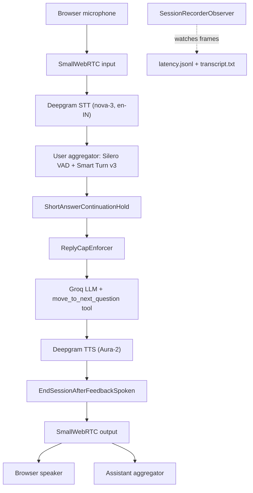
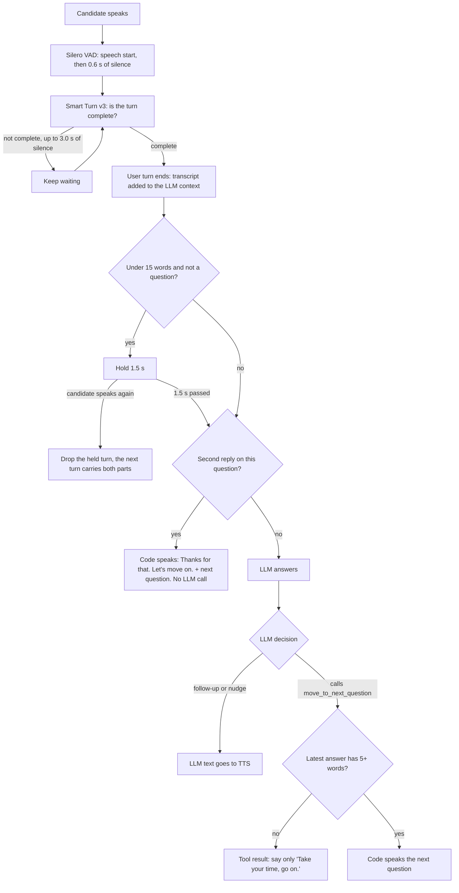
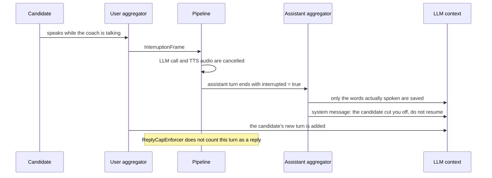

# Pipeline flow

How one interview session works, from microphone to speaker. File names refer to this repo, and the frame names are Pipecat's.

## 1. The pipeline

The order below is the order in `run_interview_session` in `bot.py`.

Code owns the interview: the question order and wording, the reply cap, the opening line and the end of the session. The LLM only decides, per answer, between a follow-up, a nudge, or calling `move_to_next_question`.

## 2. Session start

1. The browser connects over WebRTC (`POST /api/offer`) and `bot()` builds a transport and calls `run_interview_session`.
2. A new `InterviewState` (question index 0, reply count 0) and a new `SessionRecorder` (`sessions/<timestamp>/`) are created.
3. On `on_client_connected` the code queues `TTSSpeakFrame(opening line)`. The greeting and question 1 are spoken by code, not by the LLM, so the model cannot skip question 1.

## 3. One candidate turn

What each step owns:

| Step | File | What it does |
|---|---|---|
| Turn start | `bot.py` (`build_user_turn_strategies`) | VAD detects speech. While the bot is speaking, a transcript of at least 2 words also counts, so "mm" does not interrupt |
| Turn end | `bot.py` | Smart Turn v3 judges the audio once VAD sees 0.6 s of silence. If it says "not finished", a silence of `SMART_TURN_MAX_SILENCE_SECS` (3.0 s) ends the turn anyway |
| Short-answer hold | `interview_processors.py` | Gives a thinking candidate 1.5 s to continue before a short, complete-sounding turn is answered |
| Reply cap | `interview_processors.py` | Counts candidate replies per question. On the second one, code moves on without asking the LLM |
| LLM decision | `prompts.py`, `bot.py` | The system prompt decides follow-up, nudge or tool call. At most one follow-up per question |
| Tool handler | `bot.py` | Refuses to advance on answers under 5 words. Otherwise speaks the next question with `TTSSpeakFrame` and does not run the LLM again |
| State | `interview_flow.py` | `InterviewState` holds the question index and reply count, and returns the next question or the feedback instruction |

A reply is counted only if the bot spoke since the last counted reply. This stops a sentence that was split into two turns from being counted twice.

## 4. Interruption

- The user aggregator sends an `InterruptionFrame` at the start of every user turn, also when the bot is silent. `ReplyCapEnforcer` therefore only treats it as a barge-in when the bot was speaking at that moment.
- The turn is logged as `interrupted: true` and the transcript shows `[INTERRUPTED]` and `*** USER INTERRUPTED COACH ***`.
- Text that code speaks (opening line, questions) is saved to the context as one chunk, so an interrupted code-spoken question still appears whole.

## 5. Ending the session

1. After the last question, `InterviewState.advance_to_next_question()` returns the feedback instruction and the interview is in the feedback phase.
2. The instruction is added as a system message, either by `ReplyCapEnforcer` (cap reached on question 4) or as the tool result (LLM called `move_to_next_question`). The LLM then writes exactly three spoken sentences: a quoted strength, one improvement, one tip.
3. `EndSessionAfterFeedbackSpoken` sits between TTS and the output transport. It arms on the LLM response that starts in the feedback phase, and when the bot stops speaking it sends `EndWorkerFrame` upstream. The pipeline ends and the connection closes.
4. If the browser disconnects earlier, `on_client_disconnected` cancels the runner.

## 6. What is recorded

`SessionRecorderObserver` (`latency_observer.py`) watches frames without changing them, and `SessionRecorder` (`session_recorder.py`) turns them into the two output files after every change.

| Field in `latency.jsonl` | Frame it comes from |
|---|---|
| `user_stopped_ms` | `VADUserStoppedSpeakingFrame` time minus the VAD `stop_secs`, so it marks the start of the silence |
| `stt_final_ms` | last `TranscriptionFrame` before the LLM ran (never earlier than `user_stopped_ms`) |
| `llm_first_token_ms` | first `LLMTextFrame`, or the `TTSSpeakFrame` when code speaks the next question |
| `tts_first_audio_ms` | `BotStartedSpeakingFrame` from the output transport |
| `interrupted` | `InterruptionFrame` while the bot was speaking |

`scripts/latency_report.py` reads `latency.jsonl` and prints p50 and p95 of `user_stopped_ms` to `tts_first_audio_ms`, plus the average time of each stage. `transcript.txt` is built from `TranscriptionFrame` (candidate) and `TTSTextFrame` (coach).
